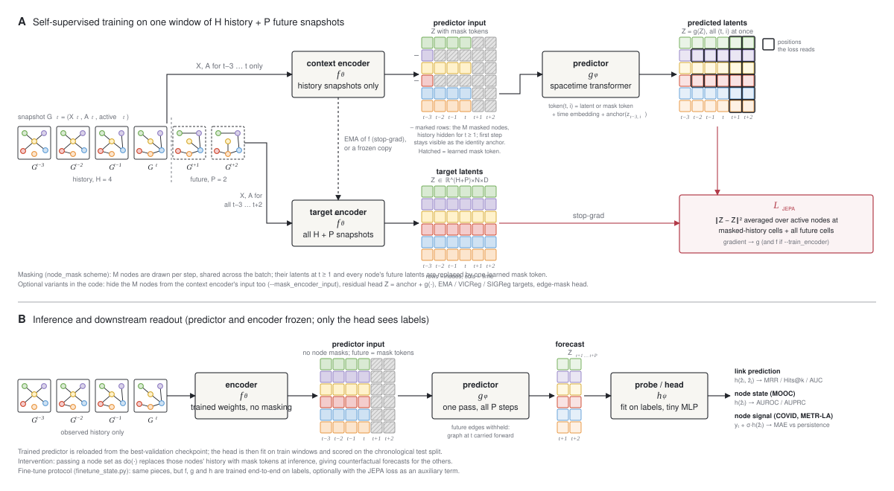

# DELOS

Joint-embedding predictive pretraining on **discrete-time dynamic graphs**:
C-JEPA's masked-slot prediction moved from object-centric video slots to graph
nodes.

- **object slots → graph nodes** (stable identity across time)
- **history frames → graph snapshots**
- **masked-history + forward prediction in latent space**, over node tokens

Prediction always happens in an encoder's latent space, never in input
(adjacency / feature) space. The target encoder is either frozen (pretrained
with a masking pretext) or an EMA copy of the online encoder. Labels enter
only at the probe stage.



```
snapshots (B,T,N,F) + adjacency (B,T,N,N)
  │  encoder (registry in src/world_models/delos_encoder.py)
  ▼
node latents (B,T,N,D)
  │  DELOSPredictor: mask nodes' history and/or the future, predict latents
  ▼
predicted latents ── JEPA loss in latent space
  │  frozen-backbone probe
  ▼
link prediction | node classification / ranking | node-signal regression
```

## Layout

The code is organised in four blocks.

| block | where | entry point |
|---|---|---|
| 1. Universal DTDG loader | `src/custom_codes/dtdg/`, one thin parser per dataset in `src/custom_codes/`, dispatch in `dataset_factory.py` | `--data_source ...` |
| 2. Encoder pretraining | encoders in `src/world_models/delos_encoder.py` (`@register_encoder`), pretext heads in `src/world_models/pretrainers.py` | `src/train/pretrain_encoder.py --pretext edge_mask\|feature_mask\|masked_signal` |
| 3. Predictor | `src/delos_predictor.py` (`DELOSPredictor`, `build_predictor`), loops in `src/train/jepa.py`, two-level variant in `src/world_models/hier.py` | `src/train/train_delos.py --mask_scheme node_mask\|future_forecast\|trajectory_block --downstream_task link_pred\|regression\|none` |
| 4. Probes | `src/world_models/probes.py`, state / class / ranking probes in `scripts/dblp/run_block_probe.py` | run by the pipelines below |

Other entry points: `src/train/finetune_state.py` (end-to-end fine-tuning),
`src/train/analyze_jepa.py` and `src/train/diagnose_trajectory_jepa.py`
(diagnostics). The shared run harness is `src/train/engine.py` + `cli.py`.

Encoder kinds: `linear`, `gcn`, `gcn_root`, `tgcn`, `ppr_gcn`, `dysat`,
`maskdgnn`, `maskdgnn_root`, `dygwm`, `dygwm_root`, `dyg2vec`.

## Datasets

Selected with `--data_source`; all flags live in
`src/custom_codes/dataset_factory.py`. Data goes under `dataset/` (not
tracked).

| `--data_source` | what | task | how to get it |
|---|---|---|---|
| `dblp` | DBLP co-authorship by year | link prediction | `scripts/dblp/preprocess_dblp_xml.py`, `fetch_preprocessed_dblp.sh` |
| `jodie_mooc`, `jodie_reddit`, `jodie_wikipedia` | JODIE bipartite interaction graphs, binned | dynamic node state, link prediction | JODIE CSVs |
| `reddit_body`, `reddit_title` | subreddit hyperlink graphs | link prediction | SNAP CSVs |
| `cldg_dblp`, `cldg_patent` | CLDG-release graphs, static node classes | node classification, link prediction | `scripts/dblp/extract_cldg_datasets.sh` |
| `chase_dblp_s`, `chase_gossipcop`, `chase_music` | CHASE graphs, per-snapshot labels | dynamic node classification | `scripts/dblp/fetch_chase.sh` |
| `tgbn_trade`, `tgbn_genre`, `tgbn_reddit`, `tgbn_token` | TGB node-property prediction | label ranking | `scripts/dblp/fetch_tgbn_trade.sh`, `fetch_tgbn.sh` |
| `bts_flights` | daily US flight network, airport delay state | dynamic node state | `scripts/dblp/fetch_bts_flights.sh` |
| `nyc_taxi` | hourly taxi-zone trip network, congestion state | dynamic node state | `scripts/dblp/fetch_nyc_taxi.sh` (needs `pyarrow`) |
| `metr_la` | traffic sensors, fixed topology | regression | `scripts/metr_la/download_metr_la.sh` |
| `england_covid` | daily mobility graph, case counts | regression | PyG-Temporal dump |
| `ehrshot` | per-patient temporal event graphs | link prediction | `scripts/dblp/preprocess_ehrshot.py` |
| `synthetic_dyn` | generated latent-driven dynamic graph | dynamic node state | none (generated) |

## Baselines

All under `src/baselines/`, each with a `train_*.py` entry point. The SSL
baselines also have a `scripts/dblp/slurm_*.sh` launcher; the forecasting ones
run through the regression pipeline.

- **Static SSL** (one snapshot at a time): GRACE, GraphMAE, BGRL.
- **Temporal SSL**: CLDG, DDGCL, IDOL, DySubC, DyG2Vec, MaskDGNN, DyG-WM,
  SG-JEPA.
- **Interaction model**: JODIE.
- **Forecasting** (regression): STD-MAE, STEP, Graph WaveNet.

## Pipelines

Each task has an `ARMS`-gated launcher, a hyperparameter sweep that reads only
the validation split, and a mean ± std LaTeX aggregator. The per-task READMEs
describe the arms and metrics.

| task | directory |
|---|---|
| dynamic node classification / state | [scripts/classification/](scripts/classification/README.md) |
| link prediction | [scripts/linkpred/](scripts/linkpred/README.md) |
| node-signal regression | [scripts/regression/](scripts/regression/README.md) |

Window geometry, binning and encoder choice per dataset are set once in
`scripts/dblp/_dataset_config.sh`, which all three pipelines source.
`scripts/dblp/` is named for historical reasons: it holds the shared config,
the per-method launchers and the data fetch / preprocess scripts for every
dataset.

Further studies:

- `scripts/synthetic/` — synthetic state sweeps, the multi-horizon showcase
  (`horizon_showcase.sh`) and the two-level run (`hier_showcase.sh`).
- `scripts/collapse/` — representation-collapse study (launcher, metrics,
  report).
- `scripts/analysis/` — dataset dynamics audit and missing-history
  experiments.
- `scripts/check_run_consistency.py` — checks that runs in one table share
  their settings.

## Setup

```bash
conda create -n cjepa python=3.10 -y && conda activate cjepa
pip install -r scripts/metr_la/requirements.txt   # torch, einops, numpy, pandas, pyarrow, h5py, huggingface_hub
pip install lxml                                   # only for DBLP XML preprocessing
```

On a V100 (CC 7.0) pin `torch==2.5.1+cu121`: PyPI wheels from 2.6 on drop
sm_70.

All scripts use absolute `src.` imports, so run them from the repository root
with `PYTHONPATH=.`.

```bash
# Smoke test: no data, no GPU
PYTHONPATH=. python src/train/train_delos.py --data_source synthetic_dyn \
    --mask_scheme future_forecast --downstream_task none --smoke --device cpu
```

## Design notes

- **Per-timestep adjacency.** `_spatial_aggregate` dispatches any adjacency
  shape — `(N,N)` static, `(T,N,N)` dynamic, `(B,N,N)`, `(B,T,N,N)` — so
  fixed-topology and evolving graphs share one code path.
- **Structural attention, sparse by default.** The predictor's spacetime mask
  (same-time neighbours + same node across time) is on by default and
  evaluated as an edge list through gather/scatter attention
  (`--attn_impl sparse`), so memory is linear in the number of allowed pairs
  rather than `(T·N)²`. `--attn_impl dense` keeps the materialised path for
  parity checks. `--no_attention_mask`
  drops the mask entirely; some pipeline scripts still pass it to reproduce
  historical runs.
- **Per-batch random node masking.** Masked node indices are resampled every
  forward pass during training (fixed seed only in eval).
- **Best-checkpoint reload before probe.** The probe evaluates the best-val
  checkpoint, not the final-epoch one.
